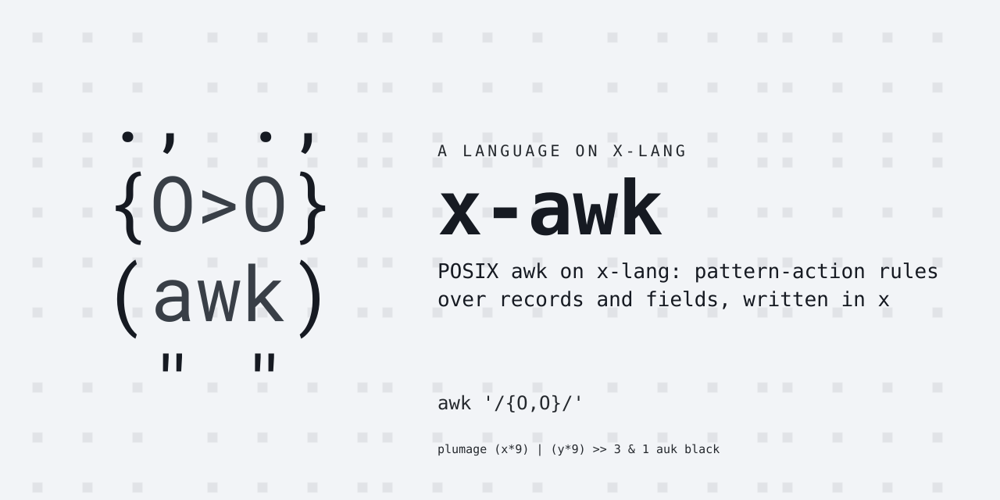
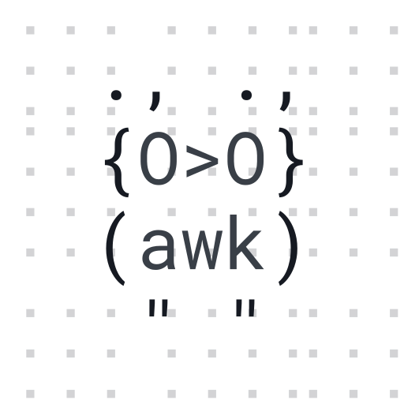

# x-awk — awk on x-lang

POSIX awk written in [x-lang](https://github.com/jonruttan/x-lang), loaded
as a lang: pattern-action rules over records and fields, and the command
line.

    printf 'a b\nc d\n' | x -l awk '{print $2}'
    x -l awk -- -F: '{print $1}' /etc/passwd
    x -l awk 'BEGIN{exit 3}'; echo $?        # 3

Numbers are exact rationals, so arithmetic that rounds in a C awk does
not round here; see [Differences](#differences).

## Status

Pre-release: no release has been cut. Paired with x-lang v0.54.0
(`lang.xon` is the checkable row). The POSIX language and command line
are in, with one gap: `exit` from inside a function.

## What it does

- **Rules.** `BEGIN`, `END` and pattern-action rules; ERE patterns and
  `~` and `!~`, compiled at parse time on x-lang's `lib/x/type/regex.x`.
- **Records and fields.** `NR`, `NF`, `FS`, `OFS`, `ORS`, and `RS` with
  paragraph mode. Assigning `$i` or `NF` rebuilds `$0` through `OFS`, and
  assigning `$0` splits it again by `FS`.
- **Values.** Exact-rational arithmetic with awk's `%.6g` output, and
  POSIX's string-or-number comparison.
- **Control flow.** `if`/`else`, `while`, `do`, `for`, `next`, `exit`,
  `break`, `continue`, and user functions.
- **Arrays.** String keys with POSIX's creation rules (a reference
  creates, `in` does not), `for (k in a)`, `delete`, and multiple
  subscripts through `SUBSEP`.
- **Strings.** `length`, `substr`, `index`, `toupper`, `tolower`,
  `split` with a string, `FS` or an ERE, `match` with `RSTART` and
  `RLENGTH`, and `sub` and `gsub` with `&`.
- **`printf` and `sprintf`.** The conversions `d i o x X u c s f e E g G
  %%` with flags, width, precision and `*`; `OFMT` and `CONVFMT` go
  through the same formatter.
- **Numbers.** `int`, `sin`, `cos`, `atan2`, `exp`, `log`, `sqrt` through
  the system's libm, the results converted back to rationals; `rand` and
  `srand` on a deterministic xorshift.
- **Input and output.** `getline` from the main input, a file or a
  command; `print > f`, `>> f` and `| "cmd"`; `close()` and `system()`.
- **The command line.** `-F`, `-v` and `-f`; files in order, with `-` and
  no file both standard input; `var=value` operands assigned in sequence;
  `FILENAME`, `FNR`, `ARGV` and `ARGC`; and `exit`'s status as the
  process's.

Input is read a record at a time: at a terminal each line is answered as
it is typed, and at the end of a pipe records are handled while the
writer is still running.

## Differences

`tests/specs/04-divergences.spec.md` records each with a case.

- **No float roundoff.** `0.1 + 0.2 == 0.3` is 1 here and 0 in a C awk.
- **`%.0f` of 2.5** rounds half up here, and half to even on C doubles.
- **`%x` of a negative number** prints a sign here, where C wraps it as
  unsigned.
- **libm results** keep ten significant digits: `printf "%.12f", sqrt(2)`
  prints `1.414213562000`.
- **Leftmost-first matching**, where POSIX ERE wants the longest match at
  the leftmost position.
- **`close` of an output pipe** answers the command's exit status, as
  POSIX and gawk have it; one-true-awk answers 0.
- **`exit` inside a function** is not built, and raises.

Options come before the program: they stop at the first operand.

## Install

It needs x-lang at the release `lang.xon` declares.

    make install        # into the x on PATH

`make install` also writes a state image, which `x -l awk` then boots
from in place of the sources.

## Running it

    x -l awk -- [-F ere] [-v a=v]... [-f prog.awk | 'program'] [file | a=v]...

`--` ends x's own options, so awk's can follow it. A line with no
options of awk's needs no `--`. `x -l awk` with no operands is an x-lang
session with awk loaded.

## Development

    make test           # the suite
    make check          # the suite against tests/contract/known-failures.txt

`(awk-run PROGRAM-TEXT INPUT-TEXT)` is the core, and the suite calls it
directly. Every end-to-end expectation in `tests/specs/03-run.spec.md`
was taken from a real awk run on the same program and input.

## Layout

    lang.xon          what the bundle is: lang, dialect, pairing, entry
    run.x             the entry
    awk/base.x        the language, assembled
    awk/prims.x       the platform layer
    awk/lex.x         program text to tokens
    awk/parse.x       tokens to a tree
    awk/split.x       records and fields, cut by the platform's lexer
    awk/eval.x        values, records, the run loop
    awk/fmt.x         printf; OFMT and CONVFMT go through it
    awk/cli.x         operands to a plan, and awk-main
    awk/printer.x     the lang's own write
    tests/            markdown specs, run by the platform's runner

## Licence

MIT No Attribution (MIT-0). See [LICENSE](LICENSE).

